<div align="center">

# 🎥 Multi Live Chat Overlay 🎥

**Satu overlay untuk membaca chat TikTok LIVE, YouTube Live, dan Twitch — lengkap dengan Top Viewers, gift sematan, riwayat bergabung, filter, tema, dan mode hemat RAM.**


Original oleh **Rizki Fadhillah** · Disempurnakan oleh **Lyzzer** 

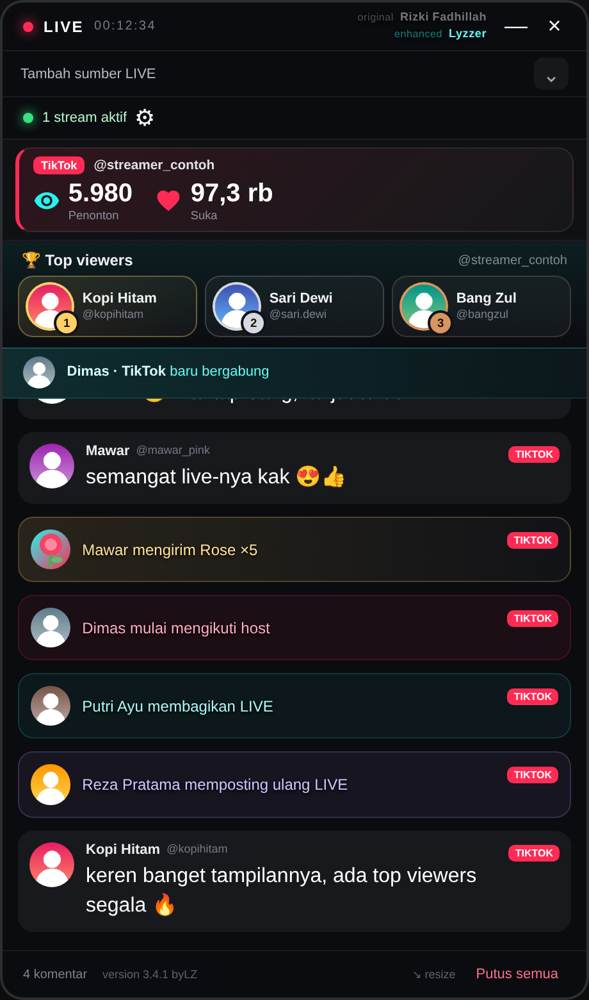

<sub>Semua tangkapan layar di dokumen ini memakai data contoh (fiktif).</sub>

</div>

---

## 📑 Daftar isi

- [Tentang proyek](#-tentang-proyek)
- [Fitur](#-fitur)
- [Unduh & pasang](#-unduh--pasang)
- [Mulai cepat](#-mulai-cepat)
- [Kontrol & hotkey](#-kontrol--hotkey)
- [Panduan pengaturan lengkap](#-panduan-pengaturan-lengkap)
- [Resep pengaturan](#-resep-pengaturan)
- [Emote TikTok](#-emote-tiktok-kode-menjadi-emoji)
- [Pemecahan masalah](#-pemecahan-masalah)
- [Struktur proyek](#-struktur-proyek)
- [Catatan, disclaimer & kredit](#-catatan-disclaimer--kredit)

---

## 🧭 Tentang proyek

Multi Live Chat Overlay membantu streamer membaca beberapa chat sekaligus tanpa berpindah jendela. Overlay dapat ditaruh di atas game, OBS, browser, atau aplikasi lain, bisa dibuat transparan, bisa dibuat **tembus klik**, dan hampir semua bagiannya dapat diatur ukuran, posisi, dan tampilannya.

Proyek ini adalah pengembangan lanjutan dari [Tiktok-Live-Chat-Overlay](https://github.com/rizkif-com/Tiktok-Live-Chat-Overlay) karya **Rizki Fadhillah**. Koneksi ke platform dan konsep dasar overlay berasal dari proyek asli. **Lyzzer** menambahkan fitur baru, memperbaiki bug, dan mengoptimalkan pemakaian memori. Ringkasannya ada di bagian [Fitur](#-fitur) (ditandai ⭐).

> Nomor versi ditulis dengan format `version X.Y.Z byLZ` di pojok kiri bawah overlay.

---

## ✨ Fitur

### Sumber & platform
- 🎵 **TikTok LIVE**, ▶️ **YouTube Live** (tanpa API key), dan 🟣 **Twitch Chat** (tanpa login)
- 🔀 Banyak stream sekaligus, dengan **badge platform** pada setiap pesan
- 📊 Statistik penonton dipisahkan per stream/platform

### Tampilan live
- 👁️ ⭐ **Total view & like** dengan ikon dan ukuran yang bisa diatur; otomatis menjadi **satu baris ringkas** di jendela kecil
- 🏆 ⭐ **Top Viewers** berupa kartu juara 1–3 lengkap dengan **foto profil** dan nomor peringkat emas/perak/perunggu
- 👋 ⭐ **Kotak riwayat bergabung** yang tingginya tetap tetapi bisa **di-scroll** untuk melihat siapa yang masuk sebelumnya
- 🎁 ⭐ **Gift sematan**: gift dipindah ke kolom sendiri (dengan riwayat yang bisa di-scroll), atau dibiarkan bercampur dengan chat
- 🔗 Notifikasi **share**, ⭐ notifikasi **repost** (kartu ungu terpisah), dan ➕ notifikasi **follow**
- 😄 ⭐ **72 kode emote TikTok** seperti `[laugh]` dan `[laughcry]` otomatis menjadi emoji
- 🖼️ Emoji/emote bergambar dan YouTube Super Sticker
- ⬇️ ⭐ **Auto-scroll cerdas**: berhenti saat kamu membaca chat lama, lalu muncul tombol **“↓ N pesan baru”**

### Kustomisasi
- 🔤 ⭐ **Ukuran terpisah** untuk komentar, username, aktivitas, bergabung, gift, Top Viewers, dan total view & like
- 🎨 ⭐ **Tema**: 5 warna aksen, 4 warna latar panel, dan opasitas
- 🧰 ⭐ **Filter**: sembunyikan bagian layar atau jenis pesan (komentar, gift, follow, share, repost)
- 🧍 ⭐ **Solo stream**: sembunyikan nama platform dan username supaya kolom lebih kecil
- 💾 ⭐ **Semua pengaturan tersimpan otomatis** ke file, termasuk setelah laptop dimatikan

### Hemat RAM
- 🧠 ⭐ **Mode memori** (High / Normal / Low) untuk membatasi jumlah riwayat
- 🙈 ⭐ **Sembunyikan foto profil**: foto benar-benar **tidak diunduh dan tidak dimuat** (hemat RAM dan data)

### Kontrol
- 📌 **Selalu di atas** (⭐ dengan hotkey `Ctrl + Shift + O`)
- 🖱️ **Klik tembus** (hotkey `Ctrl + Shift + X`) untuk dipakai di atas game
- 🪟 Ukuran jendela Kecil / Sedang / Besar dan resize manual
- ✋ ⭐ Jendela bisa digeser dari title bar, bar status, atau footer

### Lainnya
- 📱 Server companion lokal dengan token akses dan 🪶 mode Lite tanpa jendela (warisan proyek asli, lihat [catatan](#-catatan-disclaimer--kredit))

---

## 📥 Unduh & pasang

### Cara 1 — Installer (paling mudah)

1. Buka halaman [**Releases**](../../releases) di repository ini.
2. Unduh **`Multi-Live-Chat-Overlay-Setup-<versi>.exe`**.
3. Jalankan. Aplikasi terpasang otomatis tanpa hak admin, lalu terbuka sendiri. Pintasan dibuat di Desktop dan Start Menu.

Mau tanpa instalasi? Unduh **`Multi-Live-Chat-Overlay-<versi>-Portable.exe`** dan jalankan langsung.

> **Windows menampilkan “Windows protected your PC”?** File belum memiliki tanda tangan digital berbayar. Klik **More info → Run anyway**. Kalau ragu, periksa source code dan bangun sendiri (lihat di bawah).

### Cara 2 — Jalankan dari source code

**Persyaratan:** Windows 10/11 dan [Node.js](https://nodejs.org/) versi 20 atau lebih baru (pilih versi **LTS**).

```powershell
git clone https://github.com/Lyzzer-LZ/Live-Chat-Overlay-Multi-Platform.git
cd Live-Chat-Overlay-Multi-Platform
```

Lalu pilih salah satu peluncur:

| Berkas | Fungsi |
|---|---|
| `Jalankan.cmd` | **Disarankan.** Memasang dependensi pada pemakaian pertama, membuka overlay, lalu jendela CMD menutup sendiri. Overlay tetap hidup walau CMD ditutup. |
| `Jalankan-Tanpa-CMD.vbs` | Sama sekali tanpa jendela CMD. Pemasangan pertama tetap lewat CMD. |
| `Jalankan-Debug.cmd` | Menampilkan log di jendela CMD (berguna untuk mencari masalah). **Menutup jendela ini ikut menutup overlay.** |

Atau lewat terminal: `npm install` lalu `npm start`.

> Pemasangan pertama mengunduh Electron (sekitar 100 MB), jadi butuh internet dan bisa memakan beberapa menit. Peringatan `npm warn deprecated` dan `vulnerabilities` saat `npm install` berasal dari komponen pendukung dan tidak memengaruhi overlay. Jangan jalankan `npm audit fix --force`.

---

## 🚀 Mulai cepat

1. Buka overlay, lalu isi kolom **Tambah sumber LIVE**:

   | Platform | Isi dengan |
   |---|---|
   | TikTok | Username atau URL TikTok LIVE |
   | YouTube | URL LIVE, video ID, atau channel ID |
   | Twitch | Nama channel atau URL Twitch |

2. Klik **Tambah**. Ulangi untuk menambah stream lain.
3. Kolom sumber otomatis menciut setelah terhubung (klik panah di kanan untuk membukanya lagi).
4. Klik ikon **⚙** di bar status untuk membuka pengaturan. Setiap perubahan langsung terlihat dan **tersimpan otomatis**.

---

## 🎮 Kontrol & hotkey

| Kontrol | Fungsi |
|---|---|
| Tarik **title bar**, **bar status** (“stream aktif”), atau **footer** | Memindahkan overlay. Kursor berubah menjadi tangan. |
| Tarik tepi atau sudut jendela | Mengubah ukuran secara manual |
| `Ctrl` + `Shift` + `X` | Menyalakan/mematikan **klik tembus** dari aplikasi mana pun |
| `Ctrl` + `Shift` + `O` | Menyalakan/mematikan **Selalu di atas**. Muncul pemberitahuan kecil “Selalu di atas: nyala/mati”. |
| Tombol ⌃ / ⌄ | Membuka/menutup kolom sumber LIVE |
| `×` pada label sumber, atau **Putus semua** | Memutus satu atau semua stream |

> **Penting:** kalau overlay tidak bisa diklik karena klik tembus sedang nyala, tekan **Ctrl + Shift + X**.
>
> **Tips menggeser:** pegang bagian **tengah** title bar. Tepi paling atas jendela adalah area resize bawaan Windows, jadi menyeret dari sana tidak menggeser jendela.

---

## 🔧 Panduan pengaturan lengkap

Buka dengan ikon **⚙**. Pengaturan dibagi menjadi enam tab: **Ukuran · Bergabung · Gift · Tema · Filter · Lainnya**.

Panel tetap menampilkan bagian layar di atasnya, sehingga setiap perubahan bisa langsung dilihat. Slider yang berwarna abu-abu dengan ikon 🔒 sedang **terkunci** karena syaratnya belum terpenuhi (alasannya dijelaskan di bawah).

### 1. Ukuran

Mengatur besar tiap bagian secara **terpisah**: mengubah satu tidak memengaruhi yang lain.

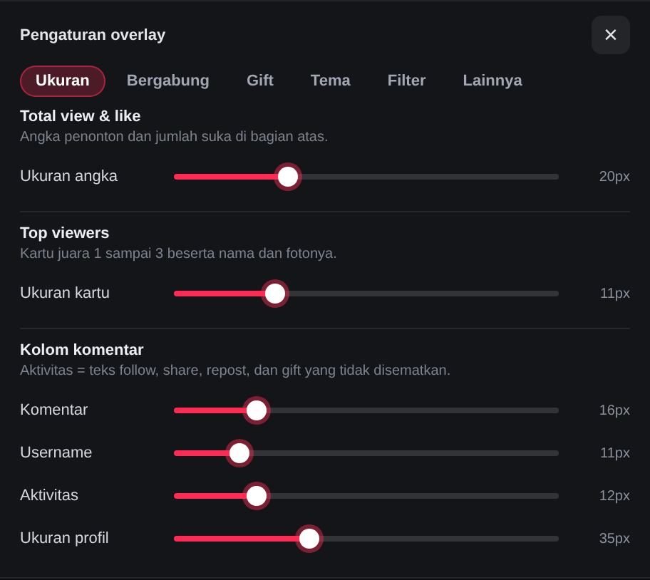

| Pengaturan | Fungsi dan efek | Rentang (bawaan) |
|---|---|---|
| **Total view & like → Ukuran angka** | Besar angka penonton dan like di kolom atas. Ikon dan keterangan ikut menyesuaikan. | 12–40 px (20) |
| **Top viewers → Ukuran kartu** | Besar kartu juara 1–3: nama, foto, dan nomor peringkat ikut membesar/mengecil. | 8–20 px (11) |
| **Komentar** | Besar teks isi komentar. | 12–32 px (16) |
| **Username** | Besar nama dan @handle di atas komentar. | 9–22 px (11) |
| **Aktivitas** | Besar teks follow, share, repost, dan **gift yang tidak disematkan** (yang tampil di dalam chat). | 9–24 px (12) |
| **Ukuran profil** | Besar foto bulat di komentar dan aktivitas. 🔒 Terkunci saat **Sembunyikan foto profil** nyala. | 24–56 px (35) |

### 2. Bergabung

Notifikasi “… baru bergabung” punya kotak sendiri yang tingginya **tetap**. Riwayatnya bisa di-scroll sehingga kotak tidak memakan ruang chat.

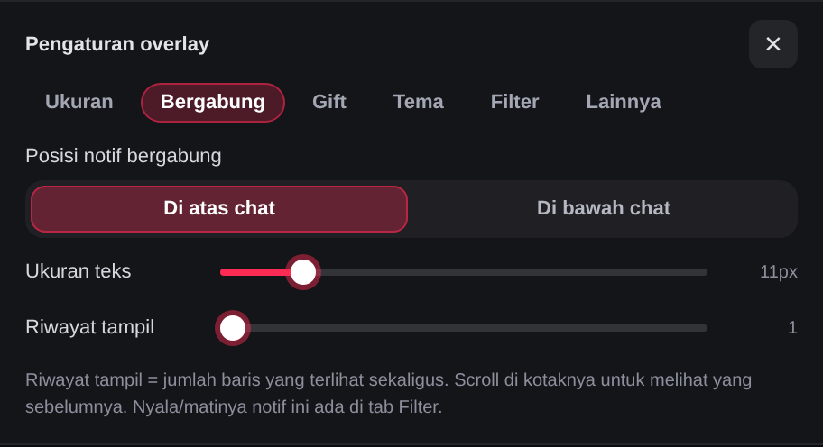

| Pengaturan | Fungsi dan efek | Pilihan (bawaan) |
|---|---|---|
| **Posisi notif bergabung** | Menaruh kotak di **atas** atau di **bawah** daftar chat. | Di atas chat |
| **Ukuran teks** | Besar teks dan foto di kotak bergabung. Tinggi kotak ikut menyesuaikan agar satu baris tetap pas. | 9–22 px (11) |
| **Riwayat tampil** | Jumlah baris yang terlihat sekaligus. Scroll di dalam kotak untuk melihat penonton sebelumnya; tombol **↓** membawamu kembali ke yang terbaru. | 1–3 baris (1) |

> Menyalakan/mematikan notif ini ada di tab **Filter**. Jumlah riwayat yang disimpan ditentukan **Mode memori**.

### 3. Gift

Pilih apakah gift bercampur dengan chat, atau dipindah ke kolom sendiri.

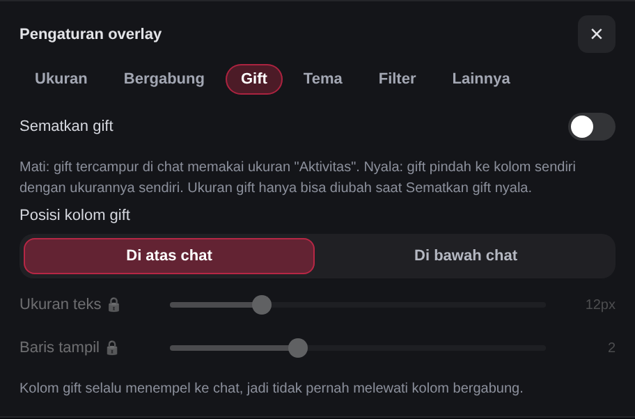

| Pengaturan | Fungsi dan efek | Pilihan (bawaan) |
|---|---|---|
| **Sematkan gift** | **Mati:** gift tampil di dalam chat dan memakai ukuran **Aktivitas**. **Nyala:** gift pindah ke kolom sendiri dengan ukurannya sendiri; chat jadi lebih bersih. | Mati |
| **Posisi kolom gift** | Menaruh kolom gift di atas atau di bawah chat. | Di atas chat |
| **Ukuran teks** | Besar teks gift sematan. 🔒 Terkunci saat Sematkan gift mati. | 9–22 px (12) |
| **Baris tampil** | Jumlah baris gift yang terlihat sekaligus; sisanya bisa di-scroll. 🔒 Terkunci saat Sematkan gift mati. | 1–4 baris (2) |

**Kenapa dikunci?** Ukuran gift hanya berpengaruh ketika kolom gift ada. Saat sematan mati, gift mengikuti ukuran **Aktivitas** di tab Ukuran, jadi slider gift dikunci agar tidak membingungkan. Nilainya tidak hilang dan aktif lagi begitu sematan dinyalakan.

**Aturan posisi:** kolom gift selalu **menempel ke chat**, sedangkan kolom bergabung berada di luar kolom gift. Gift tidak akan pernah melewati kolom bergabung.

| Posisi bergabung | Posisi gift | Urutan dari atas ke bawah |
|---|---|---|
| Di atas | Di atas | Bergabung → Gift → Chat |
| Di atas | Di bawah | Bergabung → Chat → Gift |
| Di bawah | Di atas | Gift → Chat → Bergabung |
| Di bawah | Di bawah | Chat → Gift → Bergabung |

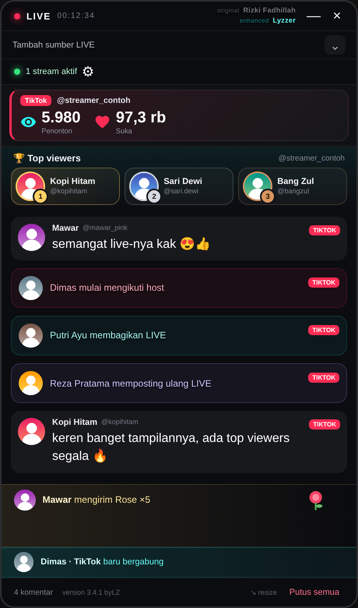

### 4. Tema

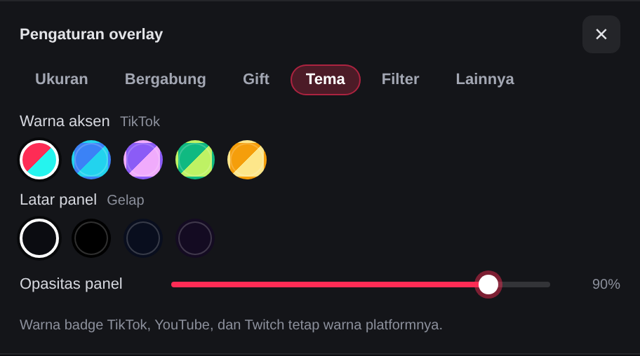

| Pengaturan | Fungsi dan efek | Pilihan (bawaan) |
|---|---|---|
| **Warna aksen** | Warna tombol, slider, switch, dan elemen berwarna lain (termasuk warna biru kotak bergabung). Badge platform TikTok/YouTube/Twitch **tetap** memakai warna platformnya. | TikTok, Samudra, Ungu, Zamrud, Emas (TikTok) |
| **Latar panel** | Warna dasar panel overlay. | Gelap, Hitam pekat, Biru malam, Ungu malam (Gelap) |
| **Opasitas panel** | Seberapa pekat latar panel. Makin kecil makin tembus pandang, sehingga game atau OBS di belakangnya terlihat. Teks tetap jelas. | 30–100% (90) |

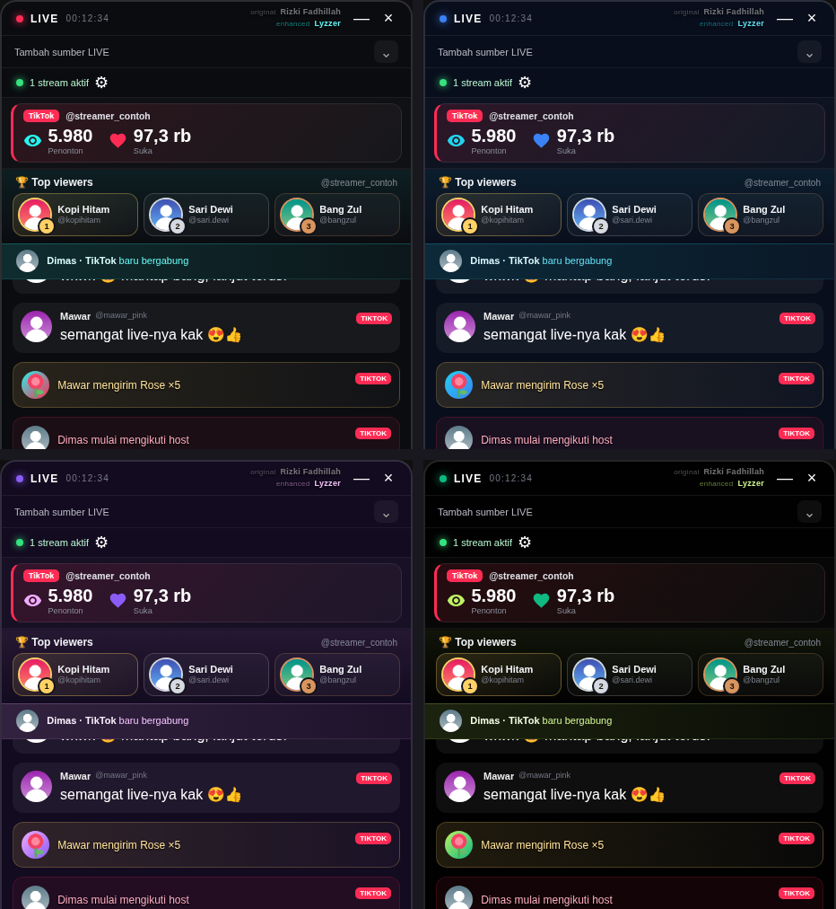

### 5. Filter

Menyembunyikan **tampilan** tanpa menghapus datanya: riwayat tetap ada dan muncul lagi saat saklar dinyalakan.

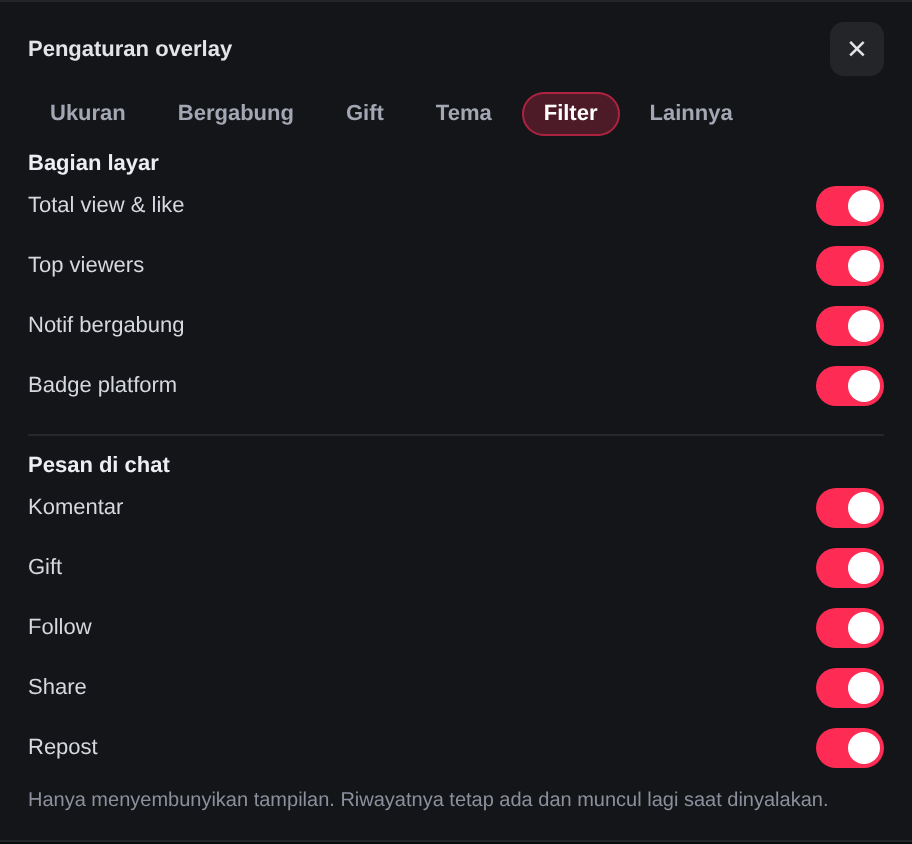

| Kelompok | Saklar | Efek saat dimatikan |
|---|---|---|
| **Bagian layar** | Total view & like | Menyembunyikan kolom statistik penonton dan like |
| | Top viewers | Menyembunyikan kartu juara 1–3 |
| | Notif bergabung | Menyembunyikan kotak riwayat bergabung |
| | Badge platform | Menyembunyikan label TikTok/YouTube/Twitch di tiap pesan (hemat ruang kalau hanya satu platform) |
| **Pesan di chat** | Komentar | Menyembunyikan komentar biasa |
| | Gift | Menyembunyikan gift (juga kolom gift sematan) |
| | Follow, Share, Repost | Menyembunyikan notifikasi jenis tersebut |

Semua saklar bawaannya **nyala**.

> Pada jendela yang sangat pendek (tinggi di bawah 560 px), **Top viewers** dan **kotak bergabung** disembunyikan otomatis untuk menghemat ruang. Kolom gift sematan tetap tampil.

### 6. Lainnya

Pengaturan jendela, hotkey, dan penghemat memori.

<table>
<tr>
<td>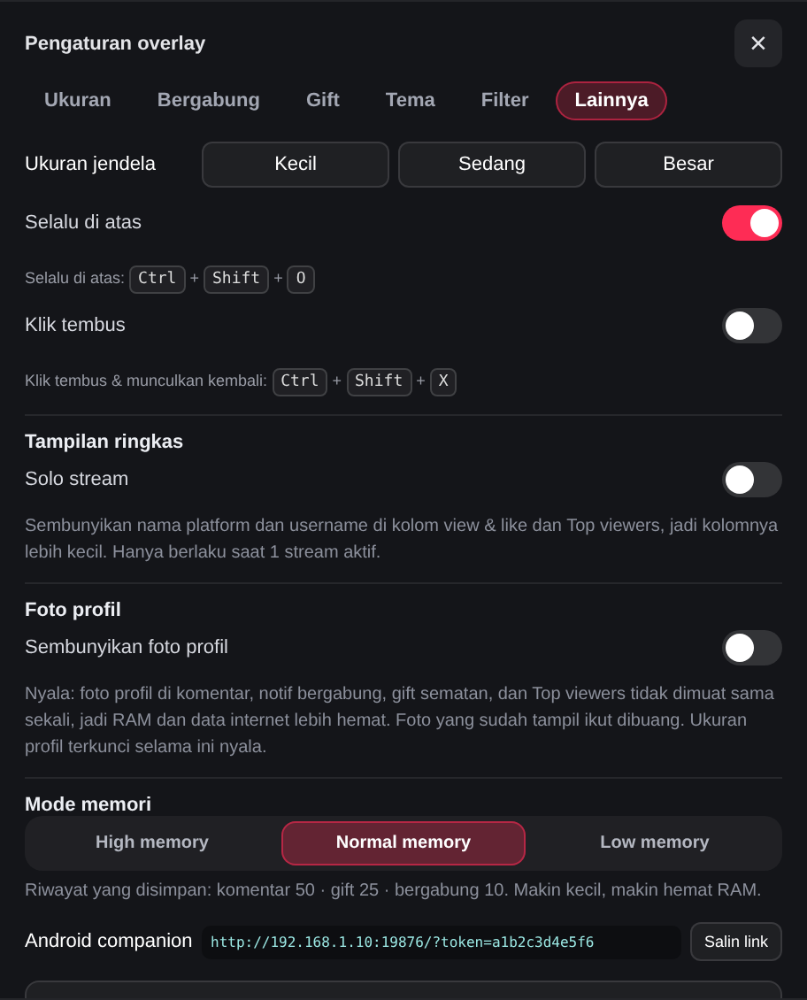</td>
<td>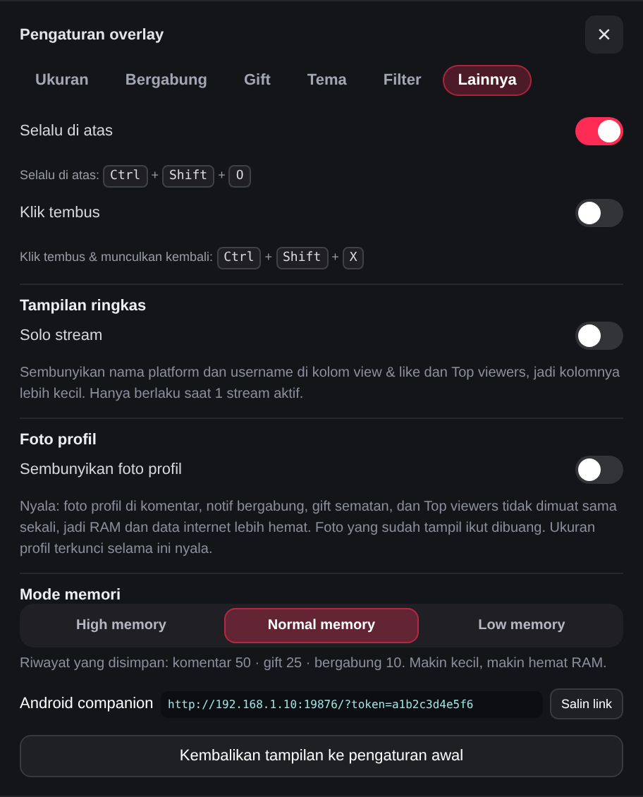</td>
</tr>
</table>

| Pengaturan | Fungsi dan efek | Pilihan (bawaan) |
|---|---|---|
| **Ukuran jendela** | Tombol cepat untuk mengubah ukuran jendela. | Kecil 320×420 · Sedang 460×700 · Besar 600×850 |
| **Selalu di atas** | Menjaga overlay di atas aplikasi lain. Hotkey `Ctrl+Shift+O`. | Nyala |
| **Klik tembus** | Klik diteruskan ke aplikasi di belakang overlay. Bagian pengaturan (title bar, bar status, footer) meredup, sedangkan **chat, statistik, Top viewers, dan kotak bergabung tetap terang**. Hotkey `Ctrl+Shift+X` untuk nyala **dan** mati. | Mati |
| **Solo stream** | Menyembunyikan nama platform dan username di kolom view & like serta label akun di Top viewers, sehingga kolomnya lebih kecil dan hanya menampilkan angka penonton dan like. **Hanya berlaku saat 1 stream aktif**; kalau ada beberapa sumber, namanya tetap tampil supaya tidak tertukar. | Mati |
| **Sembunyikan foto profil** | Lihat penjelasan di bawah. | Mati |
| **Mode memori** | Lihat tabel di bawah. | Normal memory |
| **Android companion** | Tautan lokal (Wi-Fi) beserta token akses untuk aplikasi klien. Tombol **Salin link** menyalinnya. | – |
| **Kembalikan tampilan ke pengaturan awal** | Mengembalikan semua pengaturan tampilan ke bawaan. | – |

#### 🙈 Sembunyikan foto profil

Saat dinyalakan:

- Foto profil di **komentar, kotak bergabung, gift sematan, dan Top viewers** **tidak diunduh dan tidak dimuat sama sekali**. Aplikasi tidak membuat elemen gambar untuk foto-foto itu, bukan sekadar menyembunyikannya dengan CSS.
- Foto yang **sudah tampil** ikut dibuang dari layar sehingga memorinya bisa dilepas.
- Kolom foto hilang dan teks mengisi ruangnya. Di Top viewers, nomor peringkat berdiri sendiri.
- **Gambar gift tetap tampil** karena itu bukan foto profil.
- Slider **Ukuran profil** terkunci (🔒) karena tidak ada foto yang diatur.
- Dimatikan lagi: pesan **baru** kembali memakai foto (pesan lama yang sudah dibuang tidak dimuat ulang).

Dalam pengujian dengan data contoh, mode ini membuat **0 permintaan jaringan untuk foto** dan menurunkan pemakaian memori renderer secara signifikan. Besarnya hemat tergantung ukuran foto dan jumlah pesan.

#### 🧠 Mode memori

Membatasi **berapa banyak riwayat yang disimpan** di jendela. Entri tertua dibuang otomatis. Makin kecil angkanya, makin hemat RAM. Saat kamu pindah ke mode yang lebih kecil, riwayat langsung dipangkas.

| Mode | Komentar | Gift | Bergabung | Cocok untuk |
|---|---:|---:|---:|---|
| **High memory** | 100 | 50 | 25 | PC kuat, ingin riwayat panjang untuk di-scroll |
| **Normal memory** *(bawaan)* | 50 | 25 | 10 | Pemakaian sehari-hari |
| **Low memory** | 25 | 10 | 5 | Laptop dengan RAM terbatas atau stream yang sangat lama |

> **Dengan High memory dan banyak foto**, pemakaian RAM naik karena lebih banyak foto yang ditahan. Gabungkan **Low memory** dengan **Sembunyikan foto profil** untuk hasil paling hemat.

### 💾 Penyimpanan pengaturan

- Pengaturan disimpan **otomatis** ke file `overlay-settings.json` di folder data aplikasi: setiap kali ada perubahan, saat tombol **×** ditekan, dan saat jendela ditutup. Jadi tetap ada setelah aplikasi ditutup atau laptop dimatikan.
- Lokasi pastinya tercetak di jendela konsol saat memakai `Jalankan-Debug.cmd` (baris `[pengaturan] disimpan di: …`).
- Memindahkan pengaturan ke PC lain: salin file itu ke folder data aplikasi di PC tujuan.
- Versi **terpasang** dan versi yang dijalankan lewat **`npm start`** bisa memakai folder data yang berbeda, sehingga pengaturannya terpisah.
- Pengaturan dari versi lama yang tersimpan di penyimpanan internal aplikasi dipindahkan otomatis ke file ini. Nilai yang rusak atau di luar rentang diperbaiki otomatis ke nilai aman.

---

## 🍳 Resep pengaturan

**Overlay minimalis di atas game**
1. Tab **Tema**: turunkan **Opasitas panel** ke ±60%.
2. Tab **Lainnya**: nyalakan **Selalu di atas**, **Solo stream**, lalu nyalakan **Klik tembus** (atau tekan `Ctrl+Shift+X`).
3. Tab **Filter**: matikan **Badge platform** dan **Top viewers** bila tidak diperlukan.
4. Pilih ukuran jendela **Kecil**.

**Hemat RAM maksimal (laptop/PC lawas)**
1. Tab **Lainnya**: pilih **Low memory** dan nyalakan **Sembunyikan foto profil**.
2. Tab **Filter**: matikan **Notif bergabung** bila tidak penting.
3. Gunakan ukuran jendela **Kecil**.

**Fokus ke gift**
1. Tab **Gift**: nyalakan **Sematkan gift**, pilih posisi, dan atur **Baris tampil** 3–4.
2. Tab **Filter**: matikan **Follow**, **Share**, dan **Repost** supaya chat lebih bersih.
3. Tab **Ukuran**: besarkan **Ukuran angka** agar total like mudah terlihat.

**Banyak platform sekaligus**
1. Tambahkan semua sumber. Biarkan **Badge platform** menyala agar mudah dibedakan.
2. Biarkan **Solo stream** mati: nama sumber di kolom view & like membantu membedakan stream.

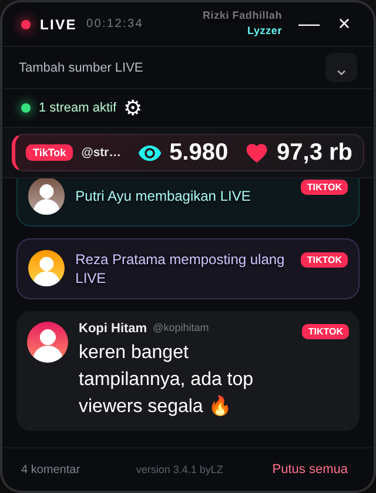

---

## 😄 Emote TikTok (kode menjadi emoji)

TikTok mengirim emote bawaannya sebagai teks, misalnya `[laugh]`. Overlay mengubah **72 kode** menjadi emoji standar.

| Kode | Hasil | Kode | Hasil | Kode | Hasil |
|---|---|---|---|---|---|
| `[laugh]` | 😄 | `[laughcry]` | 😂 | `[wow]` | 😍 |
| `[thumb]` | 👍 | `[hi]` | 👋 | `[heart]` | ❤️ |
| `[congrat]` | 🎉 | `[thanks]` | 😋 | `[rockycool]` | 😎 |
| `[sagethink]` | 🤔 | `[jolliewow]` | 🤩 | `[rosiecute]` | 🥰 |

**Kode belum dikenal tetap tampil sebagai teks.** Untuk menambahkannya:

1. Jalankan lewat **`Jalankan-Debug.cmd`**. Kode yang belum dikenal dicatat di jendela CMD sebagai `[emoji] kode belum dikenal: [namakode]`.
2. Buka **`src/emoji-map.js`** dan tambahkan satu baris di dalam daftar `MAP`:
   ```js
   namakode: '😀',
   ```
3. Jalankan ulang aplikasi.

> Hasilnya adalah emoji standar, bukan gambar asli TikTok. Gambar asli tidak bisa diambil dengan aman dari luar aplikasi TikTok.

### Share dan Repost

Keduanya tampil sebagai kartu terpisah (“membagikan LIVE” dan “memposting ulang LIVE”, berwarna ungu). TikTok tidak mendokumentasikan kode pesan untuk repost, sehingga aplikasi mengenalinya dari kode pesan/tujuan yang mengandung kata `repost`. Kalau repost tidak muncul, jalankan `Jalankan-Debug.cmd`: setiap jenis pesan sosial baru dicatat di CMD sebagai `[share] …` atau `[social] …`. Lampirkan baris itu saat membuat laporan.

---

## ❓ Pemecahan masalah

| Masalah | Penyebab / solusi |
|---|---|
| **Komentar tidak muncul** | Pastikan username benar, akun sedang LIVE dan bisa diakses publik, lalu tunggu beberapa detik setelah status terhubung. Putus lalu hubungkan lagi bila jaringan sempat putus. |
| **Jumlah penonton `—`** | Angka diperbarui ketika TikTok mengirim event statistik. Snapshot pertama bisa butuh beberapa detik. |
| **Overlay tidak bisa diklik** | Klik tembus sedang nyala. Tekan `Ctrl + Shift + X`. |
| **Jendela susah digeser** | Pegang bagian tengah title bar, bar status, atau footer. Tepi paling atas adalah area resize. |
| **Overlay tertutup game** | Nyalakan **Selalu di atas** (`Ctrl+Shift+O`). Jalankan game dalam mode *Borderless Windowed*; mode *Exclusive Fullscreen* bergantung pada izin game dan anti-cheat. |
| **Emote tampil sebagai `[xxx]`** | Kodenya belum ada di daftar. Lihat [Emote TikTok](#-emote-tiktok-kode-menjadi-emoji). |
| **Repost tidak muncul** | Lihat bagian Share dan Repost di atas. |
| **Slider abu-abu dengan 🔒** | Terkunci karena syaratnya belum terpenuhi: nyalakan **Sematkan gift** (slider gift) atau matikan **Sembunyikan foto profil** (Ukuran profil). |
| **RAM terasa besar** | Pilih **Low memory** dan nyalakan **Sembunyikan foto profil**. |
| **Overlay ikut tertutup saat CMD ditutup** | Pakai `Jalankan.cmd` atau `Jalankan-Tanpa-CMD.vbs`. Hanya `Jalankan-Debug.cmd` yang terikat pada jendela CMD. |
| **Peringatan keamanan Windows** | File belum bertanda tangan digital. Klik *More info → Run anyway*. |
| **Pengaturan kembali ke awal** | Periksa file `overlay-settings.json` di folder data aplikasi (lokasinya tercetak di mode debug). Versi terpasang dan `npm start` bisa memakai folder berbeda. |

---

## 📁 Struktur proyek

```text
.
├── src/
│   ├── main.js            # Window Electron, koneksi platform, hotkey, penyimpanan & geser jendela
│   ├── preload.cjs        # Jembatan IPC yang aman
│   ├── renderer.js        # Logika antarmuka overlay dan sistem pengaturan
│   ├── index.html         # Struktur tampilan
│   ├── styles.css         # Tampilan dasar
│   ├── controls.css       # Kontrol jendela dasar
│   ├── multi.css          # Tampilan multi-sumber
│   ├── theme.css          # Tema, ukuran terpisah, kolom gift/bergabung, pengaturan
│   ├── emoji-map.js       # Daftar kode emote TikTok → emoji
│   ├── settings-store.js  # Penyimpanan pengaturan ke file
│   └── lite-server.js     # Mode Lite (tanpa jendela)
├── .github/workflows/
│   └── build-windows.yml  # Bangun installer otomatis
├── docs/                  # Tangkapan layar untuk README
├── Jalankan.cmd           # Peluncur utama (CMD menutup sendiri)
├── Jalankan-Tanpa-CMD.vbs # Peluncur tanpa jendela CMD
├── Jalankan-Debug.cmd     # Peluncur dengan log
├── package.json
└── README.md
```

---

## 📝 Catatan, disclaimer & kredit

**Warisan proyek asli.** Server **Android companion** (WebSocket lokal dengan token, port `19876`) dan **mode Lite** (`npm run start:lite -- --tiktok username --youtube "URL" --twitch channel`, tanpa jendela overlay ini) berasal dari proyek asli. Aplikasi klien Android dan Xbox Game Bar Widget yang disebut di README asli **tidak disertakan** di repository ini. Bagian-bagian ini tidak diubah dan tidak diuji ulang di versi ini.

**Library tidak resmi.** Proyek ini memakai [`tiktok-live-connector`](https://www.npmjs.com/package/tiktok-live-connector), library tidak resmi yang membaca event webcast TikTok LIVE publik. Proyek ini:

- tidak berafiliasi, disponsori, atau didukung oleh TikTok maupun ByteDance;
- tidak meminta password TikTok;
- hanya ditujukan untuk membaca aktivitas LIVE yang dapat diakses publik;
- dapat berhenti bekerja apabila TikTok mengubah endpoint, format event, atau kebijakan aksesnya.

Gunakan secara bertanggung jawab dan patuhi ketentuan platform yang berlaku.

**Lisensi.** Repository asli belum mencantumkan berkas lisensi. Oleh karena itu Saya(lyzzer) tidak menambahkannya juga, dan minta izin sebelum mendistribusikan ulang.

**Kontribusi.** Fork repository ini, buat branch baru, commit perubahanmu, lalu buka Pull Request dengan penjelasan yang jelas. Untuk laporan bug, sertakan versi aplikasi, versi Windows, pesan error, dan langkah mereproduksinya.

### 👥 Kredit

| Peran | Nama |
|---|---|
| **Pembuat Versi Sebelumnya (Source Code)** | **Rizki Fadhillah** — [Tiktok-Live-Chat-Overlay](https://github.com/rizkif-com/Tiktok-Live-Chat-Overlay) |
| **Penyempurna** (fitur baru, perbaikan bug, optimasi) | **Lyzzer** (https://www.tiktok.com/@.xlyzzer) |

Jika proyek ini membantu, beri ⭐ pada repository, dan jangan lupa dukung proyek aslinya.

---

<div align="center">

Enhanced by Lyzzer for Streamers on Earth

</div>
